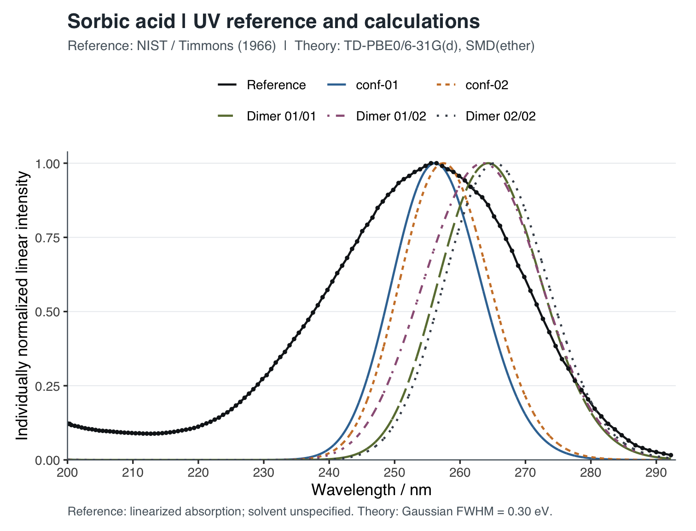
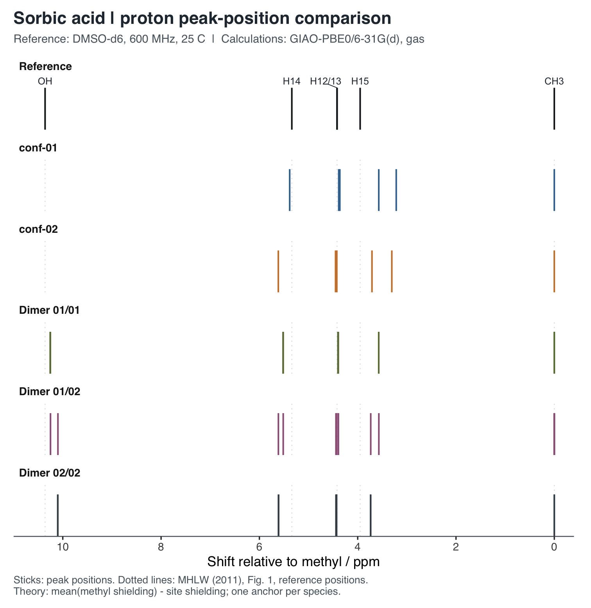

# Quantum2：山梨酸紫外光谱与核磁共振谱的计算

山梨酸（`(2E,4E)`-己二烯酸）的构象、紫外吸收、核磁屏蔽和自旋耦合计算，以及单体、双氢键二聚体与文献实验数据的比较。

仓库：[populuscathayana/Quantum2](https://github.com/populuscathayana/Quantum2)

前一实验：[Quantum1：苯甲酸 IR / Raman](https://github.com/populuscathayana/Quantum1)

[实验报告 PDF](experiment-report/sorbic_acid_uv_nmr.pdf) · [LaTeX 源码](experiment-report/sorbic_acid_uv_nmr.tex) · [环境与复现说明](ENVIRONMENT.md) · [数据来源与第三方声明](THIRD_PARTY_NOTICES.md)

## 内容

- 三个山梨酸单体构象的优化与频率分析；conf-02 为本组最低能构象。
- conf-01、conf-02 的 UV 和 NMR 计算。
- 01/01、01/02、02/02 三种环状双氢键二聚体的优化、频率、UV 和 NMR 计算。
- 与 NIST 紫外参考曲线、文献氢谱和碳谱峰位及两个耦合常数的比较。

共保留 **16 项计算、48 个计算文件**：每项包含输入 `.gjf`、文本输出 `.out` 和格式化检查点 `.fchk`。conf-03 用于构象稳定性比较，未计算其 UV / NMR。

## 图示





更多图表位于 [理论比较](analysis/comparison/) 和 [实验比较](analysis/experimental/)。

## 计算与比较方法

| 项目 | 方法 |
|---|---|
| 几何优化与频率 | 气相 PBE0/6-31G(d)，中性单重态 |
| UV | TD-PBE0/6-31G(d)，SMD 乙醚；单体 20、二聚体 40 个单重态 |
| NMR | 气相 GIAO-PBE0/6-31G(d)，`NMR=(GIAO,SpinSpin,Mixed)` |
| UV 展宽 | 能量域 Gaussian，FWHM = 0.30 eV |
| 理论 NMR 展宽 | 每个核等面积 Lorentzian；H / C 的 FWHM 分别为 0.08 / 0.80 ppm |
| 实验 NMR 比较 | 甲基参照的相对位移；碳谱分别比较文献逐碳归属与排序峰列 |

理论体系间的 UV 振幅按山梨酸单元数归一化；实验 UV 叠图则将每条曲线分别归一化到其最大值。理论 NMR 图的横轴是屏蔽常数，不是 TMS 化学位移。实验 NMR 图使用文献峰位绘制棒图，不重构实测线形。具体处理见报告和脚本。

conf-02 的最强垂直跃迁为 257.44 nm，NIST 曲线的峰顶平台为 255.56–256.41 nm；三种二聚体的展宽峰位为 263.53–265.31 nm。构象与缔合会改变谱线，但本项目未据此拟合溶液中的组分比例。

## 快速复现

先按 [ENVIRONMENT.md](ENVIRONMENT.md) 安装 Python 依赖；重绘谱图还需要 R 和 ggplot2。**后处理不需要 Gaussian、Open Babel 或集群连接。**

```bash
git clone https://github.com/populuscathayana/Quantum2.git
cd Quantum2
python3 -m venv .venv
source .venv/bin/activate
python -m pip install -r requirements.txt

# 核验计算文件，重建数值表格并检查报告数据
python reproduce.py --data-only --verify-raw

# 重绘结构与光谱图，保留已提供的轨道图
python reproduce.py

# 连同轨道图一起重建
python reproduce.py --verify-raw --orbitals
```

上述命令会更新 `analysis/` 下的派生表格和图像，不修改计算文件或报告，也不会重新执行量子化学计算。报告排版是可选的独立步骤。

## 文件结构

| 路径 | 内容 |
|---|---|
| `data/calculations/<体系>/` | 16 项计算的输入、输出及 fchk |
| `data/manifest.json` | 文件清单、公开副本与原始结果的对应关系 |
| `analysis/stage1/`、`analysis/dimers/` | 单体与二聚体的结构、能量、频率核验记录 |
| `analysis/stage2/`、`analysis/conf01/`、`analysis/dimer-properties/` | 性质数据、基准谱图及轨道图 |
| `analysis/comparison/` | 单体与二聚体理论比较 |
| `references/experimental/` | 带来源的实验数值摘录 |
| `analysis/experimental/` | 实验比较表格、残差和图像 |
| `scripts/`、`reproduce.py` | 离线核验、数值处理、绘图与检查 |
| `experiment-report/` | 报告 TeX 和已编译 PDF |

`.out` 是路径脱敏副本：每个文件仅替换一行程序/临时目录路径，科学输出和原有软件声明保留。`.gjf` 和 `.fchk` 未改动。原始二进制检查点、服务器连接与调度记录、打包文件、文献全文和封面标识源图不随仓库分发。`.gitignore` 采用允许列表，保留本地工作资料但不加入版本控制。

## 数据来源与许可

UV 来自 [NIST Chemistry WebBook：山梨酸](https://webbook.nist.gov/cgi/cbook.cgi?ID=C110441&Mask=400)；氢谱来自日本厚生劳动科学研究报告；碳谱与耦合常数来自 Nishiyama 等（1991）的[原始论文](https://doi.org/10.1248/jhs1956.37.89)。文献条件、页码、原子编号映射记录在 `references/experimental/`，详见 [第三方声明](THIRD_PARTY_NOTICES.md)。

与 Quantum1 一致，作者有权许可的原创代码及文档采用 [MIT License](LICENSE)。第三方数据、软件声明和标识仍遵循其原有权利与使用条件，不因本仓库的许可证而获得额外授权。
